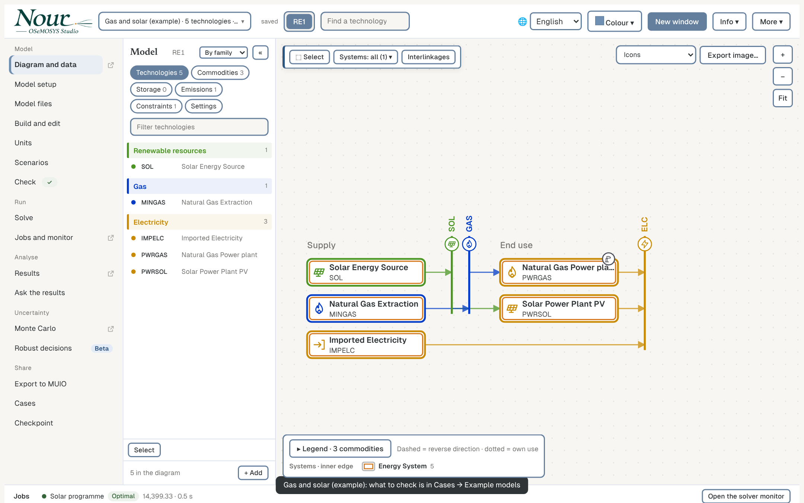

# Nour OSeMOSYS Studio 0.22.1

[](https://doi.org/10.5281/zenodo.24117127)

Build, check, solve and analyse OSeMOSYS models (energy models, and climate-land-energy-water "CLEWs" models) on your
own computer, with the standard OSeMOSYS model built in. The Studio draws the reference energy system and lets you build
the model on it or with forms, checks the data before solving, solves with HiGHS, GLPK or CBC (Gurobi if you have it),
shows every result with its meaning and unit, answers questions about the results written in your own words, and runs
Monte Carlo and robust decision making analyses. MUIO cases are imported and exported.
Everything runs on your computer: nothing is sent over the internet.



## Contents

1. [Download and start](#1-download-and-start)
2. [The screen](#2-the-screen)
3. [Build a model](#3-build-a-model)
4. [Model setup and units](#4-model-setup-and-units)
5. [Scenarios](#5-scenarios)
6. [Check](#6-check)
7. [Solve](#7-solve)
8. [Results](#8-results)
9. [Ask the results](#9-ask-the-results)
10. [Uncertainty: Monte Carlo and robust decisions](#10-uncertainty-monte-carlo-and-robust-decisions)
11. [Cases, model files, MUIO and files](#11-cases-model-files-muio-and-files)
12. [Languages, colours and windows](#12-languages-colours-and-windows)
13. [The example: Gas and solar](#13-the-example-gas-and-solar)
14. [Documentation](#14-documentation)
15. [Command-line tools and tests](#15-command-line-tools-and-tests)
16. [Build the desktop application](#16-build-the-desktop-application)
17. [Source folders](#17-source-folders)
18. [How to cite](#18-how-to-cite)
19. [Licence and third-party software](#19-licence-and-third-party-software)

---

## 1. Download and start

There are three ways to run the Studio.

### Desktop application (Windows 10 / 11)

Download the installer `Nour_OSeMOSYS_Studio_Setup_0.22.1.exe` from the
[Releases](https://github.com/Islam-Dj/Nour-OSeMOSYS-Studio-Standard/releases) page of this repository, or from
[Zenodo](https://doi.org/10.5281/zenodo.24117127), and run it. It installs the Studio for your user (no
administrator rights needed), adds a Start-menu entry and, if you tick it, a desktop shortcut.

Nothing else is needed: Python, the solvers HiGHS, GLPK and CBC, and everything else are included. The Studio opens in
its own window (it uses Microsoft Edge WebView2, part of Windows; if WebView2 is missing, the Studio opens in your web
browser instead). Your work is kept in `Documents\Nour OSeMOSYS Studio`; uninstalling the program keeps this folder.
See [desktop/README_APP.txt](desktop/README_APP.txt).

The installer is not signed, so Windows may first show *Windows protected your PC*: choose **More info**, then
**Run anyway**.

### From the source code (Windows, macOS, Linux; Python 3.10 or later)

Get the source code: **Code > Download ZIP** on this page, the source archive of a release, the Zenodo record, or

```
git clone https://github.com/Islam-Dj/Nour-OSeMOSYS-Studio-Standard.git
```

Then, in the folder of the Studio:

```
pip install -r desktop/requirements_app.txt
python run_studio.py
```

`desktop/requirements_app.txt` also installs PyInstaller and pywebview, which are used only to build the desktop
application. Instead, a start script can install what is missing (swiglpk, highspy, pandas, openpyxl, werkzeug, numpy,
scipy) and start the Studio:

- Windows: double-click `START_SOLVER.bat`
- macOS / Linux: `sh start_studio.sh`

With the start scripts, CBC is added with `pip install "pulp>=2.7,<3"` (its executable comes with PuLP).

The Studio opens in your web browser at `http://127.0.0.1:8775`. The server listens on your own computer only.

```
python run_studio.py [--port 8775] [--cases FOLDER] [--runs FOLDER] [--no-browser]
```

Cases are kept in `cases/` and runs made without a case in `runs/`, next to the Studio, unless you give other folders.

### Single file, no server

Open `Nour_OSeMOSYS_Studio.html` (in the source code) in a web browser. You can build and edit models; they are kept in
that browser (**Save data.txt** writes a copy on disk). Solving, case folders, Monte Carlo, robust decisions and the MUIO
import and export need the server: the desktop application or `python run_studio.py`.

### The first start

At start the Studio asks how to begin: continue the last case, start a new case with the built-in model (or with one of
your model files), see the cases of a model, or open the example. Tick **Do not ask at start** to reopen the last case
directly next time. The example, *Gas and solar*, is a good place to begin ([section 13](#13-the-example-gas-and-solar)).

---

## 2. The screen

| Part | What it holds |
|---|---|
| Top bar | The open case (click it to see all cases), its save state, the regions, **Find a technology**, the language, the colour of the Studio, **New window** (a second view for a second screen), **Info** and **More**. |
| Left menu | The workflow:<br>**Model**: Diagram and data · Model setup · Model files · Build and edit · Units · Scenarios · Check<br>**Run**: Solve · Jobs and monitor<br>**Analyse**: Results · Ask the results<br>**Uncertainty**: Monte Carlo · Robust decisions<br>**Share**: Export to MUIO · Cases · Checkpoint |
| Model browser | Every technology, commodity, storage, emission and constraint of the model, by family or by system, with a filter. Click an item to open its page. |
| Diagram | The reference energy system: technologies as boxes, commodities as vertical lines, flows as arrows. Hover to highlight, click to open, Ctrl + click to select several. **Export image…** writes the diagram as an image. |
| Side panel | The page of what you opened: a technology, a commodity, a form. It keeps your place (open sections, scroll, search) when it is drawn again after an edit. |
| Jobs bar | The runs in progress and the last ones; **Open the solver monitor** shows their logs. |

Every edit can be undone with Ctrl+Z and redone with Ctrl+Y (60 steps). Ctrl+K finds any technology, commodity,
storage, emission or parameter. *Info > Keyboard and mouse* lists all the shortcuts.

---

## 3. Build a model

*Model > Build and edit* turns the forms on.

| | |
|---|---|
| **New model** | A name, the regions (codes separated by commas), the first and last year, then the time structure, the modes of operation, the discount rate and the emissions. The Studio then asks for the *systems* of the model (energy, water, land…): each item belongs to one, and its units are proposed from it. |
| **Time structure** | Time slices = seasons × day types × day parts.<br>• **Seasons**: their names and days (e.g. Winter, Spring, Summer, Autumn: 90, 92, 92, 91 days). Presets: 4 seasons, 12 months from January, 12 months from September (hydrological year), one season.<br>• **Day types**: kinds of days that repeat every week, with their days per week (Weekday, Weekend: 5, 2); one day type, "All days" with 7, is the usual choice.<br>• **Day parts**: the daily time brackets (Day, Night) and their hours (12, 12).<br>Tick **The hours of the day parts change with the season** when a summer day is longer than a winter day: a table of hours by season and day part appears, and **Day and Night hours from the latitude** fills it for the latitude of your region. A table lists every time slice with its days, hours and `YearSplit`, and checks that the shares add up to 1. The Studio writes `YearSplit`, `DaySplit`, `DaysInDayType` and the conversion tables of the slices for you. |
| **One limit of the standard model** | `DaySplit`, the length of a day part used by the storage equations, has one value per day part for the whole year. When the hours change with the season, the Studio gives it the average over the year and says so on the form; `YearSplit`, which carries every energy balance, keeps the exact hours of each season. |
| **Items** | The build bar offers **+ Commodity**, **+ Technology**, **+ Storage**, **+ Emission** and **+ Constraint (UDC)**. A technology gets its inputs and outputs (the commodities it uses and produces) and the diagram draws the flows at once. |
| **The page of a technology** | Description, system and units of capacity and activity; **Years this technology is on** (switched off, built only from a year, used only from a year: the Studio writes the matching limits); the parameters by topic: performance (capacity factor, life), ratios (inputs and outputs per unit of activity), costs, limits, emissions. Each parameter shows its index sets, default and unit; **i** opens its page in the Parameter Reference. |
| **Grids** | Values are typed the Excel way: select, type, Enter; copy and paste from Excel; Ctrl+D fills down, Ctrl+R right. The **Fill** menu writes a straight line, a growth rate or a constant over the years. **Set … for several …** gives one value of a parameter to many items at once. |
| **Demand** | On the commodity that is consumed: `SpecifiedAnnualDemand` (the energy of each year) and `SpecifiedDemandProfile` (its share in each time slice, adding up to 1), or `AccumulatedAnnualDemand` for a demand with no time shape. |
| **Save** | The case is saved automatically (the chip next to the case name says *saved*). **Save data.txt** writes the data file for GLPK or MUIO; **Checkpoint** keeps a frozen copy you can go back to. |

---

## 4. Model setup and units

*Model > Model setup* shows the whole model one topic at a time, for every item at once: what is set, where, and how it
moves over the years.

| Section | What it shows |
|---|---|
| Time and discounting | Years, regions, seasons, day types, day parts, time slices with their YearSplit, discount rates |
| Demand and balances | The demands and their profiles |
| Limits and targets | Capacity, new capacity and activity limits, by year and over the horizon |
| Operational profile | A fixed shape of the activity over the slices |
| Emissions | Each emission: what emits it, its penalty and limits |
| User-defined constraints | Each constraint: its terms (multipliers), its constant and its type |
| Storage | Each storage: the technologies that charge and discharge it, its capacity and costs |
| Trade and prices | Trade routes between regions |
| Scenarios | The scenarios of the case |

*Model > Units* sets the unit of capacity and activity of every technology, the unit of every commodity, emission and
storage, and the currency. Units are proposed from the system of each item (land in 10³ km², water in 10⁹ m³, crops in
Mt, energy in PJ, money in M$), and you can add your own. As in MUIO, units are labels: they are written in the data file
and shown with every value and result; they do not convert numbers.

---

## 5. Scenarios

As in MUIO, the *base* holds every value and a scenario holds only the values it changes. A run applies the base, then
the scenarios you choose, in order.

- **+ Scenario** creates a scenario; **Edit this scenario** makes it the target of your edits: every value you type goes
  into it (the top bar shows which scenario you are editing). **Edit the base** goes back.
- **Show changes** lists the values of a scenario; **Duplicate**, **Rename** and **Delete** manage it.

The data file still runs unchanged in GLPK and MUIO: the scenarios are kept in comment lines.

---

## 6. Check

*Model > Check* looks at the data for mistakes that make a model infeasible or wrong: shares that do not add up to 1,
negative values where they make no sense, limits that contradict each other, demands with no producer, capacities that
are free and unlimited, user constraints that cannot be met. Each finding says what is wrong and how to fix it, and leads
to the cell.

**Check feasibility (exact)** builds the problem without costs and, if it has no solution, gives the smallest changes of
the limits that make it feasible.

---

## 7. Solve

*Run > Solve* opens the run form: the scenarios to apply (in order), the solver and its options, and a name for the run.
The run goes to the jobs bar and you can keep working while it solves.

| Solver | Options | When to use it |
|---|---|---|
| HiGHS | interior point (IPX or HiPO), simplex, PDLP, or HiGHS's own choice; crossover; threads; time limit; feasibility tolerance | The default: fast and robust for most models |
| GLPK | simplex or interior point; time limit | The reference of MUIO: small models, or to compare with MUIO |
| CBC | simplex or barrier; threads; time limit | Models with whole units (integer builds) |
| Gurobi | method, crossover, threads, time limit, tolerance | Very large models, when you have Gurobi installed with a licence (it is not included) |

GLPK always builds the problem from the model file and the data, exactly as MUIO does; the chosen solver then solves it.

| | |
|---|---|
| **Objective** | The Studio reports the full objective of the model file. OSeMOSYS objectives contain a constant part (e.g. the discounted fixed cost of the residual capacity) that the LP / MPS files written by GLPK leave out, so MUIO shows the objective without it. The run panel shows both numbers. |
| **Shadow prices** | The duals of the constraints are among the results: for a balance, the marginal cost of the commodity; for an emission limit, the carbon price. |
| **Jobs and monitor** | The log of each run, its progress and its status; stop a run, open its results. |
| **Each run** | A folder `runs\<run>\` inside the case: the data, the model, the log, the status, the solution and `results\<Variable>.csv`. |
| **If a run is infeasible** | The Studio says so and points to the data: run **Check feasibility (exact)** to find the limits to change. |

---

## 8. Results

*Analyse > Results* lists every result of the runs by topic (capacity, activity, production and use, costs, emissions,
storage, trade), each with its meaning and unit (*Info > Meaning of every result*).

1. Tick one or several runs and one or several results.
2. Drag the fields (YEAR, TECHNOLOGY, COMMODITY, REGION, TIMESLICE, …) to *Rows*, *Columns* or *Panels*; click a field
   to filter its members.
3. Choose the aggregation (sum, mean, minimum, maximum) and how to show the values (value, share of each row or column,
   difference or change from a base member, index, growth).
4. Choose the kind of chart (stacked or grouped columns, lines, areas, heat map, Sankey, …) and its style: titles, units,
   colours, fonts, legend names.

**Save chart** keeps the chart with the case; **Export** writes the table (Excel, CSV) or the chart (PNG, SVG). Results
by time slice (activity, production, use, storage charge and discharge, emissions) show how a yearly result varies over
the seasons and day parts.

---

## 9. Ask the results

*Analyse > Ask the results* answers a question written in your own words, in English, French, Spanish or Arabic. There
is no AI: the Studio reads the question on your computer with the names of your model and computes the answer from the
results of the run. Nothing leaves your computer.

| Part of a question | Examples | How it is found |
|---|---|---|
| What | emissions, capacity, new capacity, investment, cost, production, use, demand, activity, storage level, exports, yield | A word list in four languages, or the exact name of a result (`UseByTechnology`) or of a parameter (`CapitalCost`) |
| Which items | PWRSOL, "the solar power plant", electricity, region RE1 | The codes of your model, or the words of their descriptions |
| When | 2045, 2030-2050, from 2030 to 2050, the last year | The years of the run |
| How | by technology, by year, per season, the most, the least, the share, the total, without counting X | A few words in four languages |
| Which run | the name of a run, or **Compare with** | The runs of the case |

Examples: *Emissions in 2030* · *Capacity by technology in 2040* · *Which technology produces the most electricity?* ·
*Share of the electricity produced by PWRSOL in the total electricity each year* · *UseByTechnology PWRGAS GAS per season
in 2030*.

Every answer shows **How I read the question**: the result used, the items, the years, what was summed and the run. When
a name fits several items, the Studio asks you to choose. **Open in Results** opens the same chart with its filters.
Different gases are never added together, nor items in different units; capacities and storage levels are never added
over the years; a share is always the part of the total of the same year.

---

## 10. Uncertainty: Monte Carlo and robust decisions

### Monte Carlo

*Uncertainty > Monte Carlo* draws many values of the uncertain parameters, solves the model for each draw, and shows the
spread of the results.

1. Choose the uncertain parameters (**Add** proposes a setting for each one): a distribution (uniform, normal,
   triangular, …) or a range, applied as a multiplier of the base or as values, over all years or from a year.
2. Link values that move together (a driver) and set correlations between parameters.
3. Choose the sampling (Latin hypercube is recommended; Halton and Sobol sequences are offered too), the number of
   samples and the results to keep.
4. Run. The results show distributions, percentiles over time, the inputs against the results sample by sample, and
   which uncertainty drives a result (rank correlation).

### Robust decisions (beta)

*Uncertainty > Robust decisions* compares strategies across many futures, following the XLRM framework:

| | |
|---|---|
| **X: uncertainties** | What you cannot control: each future is one draw of the Monte Carlo uncertainties. |
| **L: strategies** | What you can decide: each strategy is a set of scenarios of the case. |
| **R: the model** | Solved once for every strategy in every future. |
| **M: metrics** | The numbers that judge a strategy in a future (cost, emissions, water, formulas of inputs and outputs), summed over the years in one of fourteen ways, with optional targets. |

The views compare the strategies: a scorecard, the regret of each strategy, the targets met (all, any, at least k, an
expression), the trade-offs between two metrics, and the futures where a strategy fails. Every view can be exported to
Excel, and **Export everything (zip)** writes the whole run: every drawn value with its index sets, the metrics, the
results and, if wished, the data file of each strategy in each future.

---

## 11. Cases, model files, MUIO and files

| | |
|---|---|
| **Cases** | *Share > Cases* lists your cases by model file, in folders you create (a country, a paper, a test series): **Open**, **Duplicate**, **Name and description**, **Delete**. **Back up (zip)** writes the whole case in one file (data, model file, scenarios, runs and their results, Monte Carlo and robust-decision runs, checkpoints); *More > Restore a Studio backup* brings it back as a new case. |
| **Where cases are kept** | One folder per case, grouped by model file: `cases\<model>\<case>\` with `data.txt` (the data file, MathProg), `model.txt` (the model file of the case), `case.json` (name, descriptions, settings, saved charts) and `runs\<run>\`. The desktop application keeps them in `Documents\Nour OSeMOSYS Studio`. **Show folder** opens the folder of a case; copy a case folder to move it to another computer. |
| **Model files** | *Model > Model files* lists the model files you work with. The standard OSeMOSYS model is built in; you can add your own model files (with a name and a description) and choose the one each case uses. Opening a data file proposes the model file whose parameters and sets match it best. |
| **Import from MUIO** | *More > Import a MUIO case (zip)* reads a MUIO case backup with its data, scenarios, units, descriptions and runs. It uses MUIO's own code, so the values are exactly those MUIO solves. |
| **Export to MUIO** | *Share > Export to MUIO* creates a MUIO case from the model and, if wished, a run, using MUIO's own code (MUIO installed on the computer). The units, the currency and each commodity's balance level (time slice, season or year) are written too. |
| **Data files** | *More > Open data file* reads any OSeMOSYS / MUIO data file (MathProg); you can also drop it on the page. You can also add a data file to the open case (**Add a model to the open case**): the Studio shows what it will add before doing it. |
| **Descriptions and Excel** | **Load descriptions (CSV)** adds descriptions from a file of `code,description` lines. **Export the model description (Excel)** writes one workbook that describes the whole model. |
| **Comment lines** | The Studio keeps its own information in the data file as comment lines that GLPK and MUIO ignore (descriptions, colours, icons, units, scenarios, the years a technology is on), so the data file stays a valid OSeMOSYS data file. |

---

## 12. Languages, colours and windows

- **Languages**: English, Français, Español and Arabic (written right to left), from the language menu of the top bar.
  The diagram, the charts, the data grids, codes and numbers stay left to right in every language. Parameter
  descriptions and long help texts are in English.
- **Colour and theme**: **Colour** sets the one colour of the Studio (box edges, the item you click, buttons);
  *More > Light / dark theme* switches the theme. Charts use one colour family by default; their colours can be changed
  in **Chart style**.
- **Second window**: **New window** opens a second view (for a second screen) that follows the first: the same case,
  region, year and selection.

---

## 13. The example: Gas and solar

The example is in *Cases > Example models*, or **Open the example** at start. One region, RE1, from 2025 to 2050, four
seasons × day and night, one emission (CO₂). Domestic gas (MINGAS) feeds a gas power plant (PWRGAS); a solar PV plant
(PWRSOL, fed by the free source SOL) and electricity imports (IMPELC) complete the supply of an electricity demand of
100 PJ in 2025 growing 4 % a year. The model has no place: rebuild it for your own region with **New model**.

Try it: look at the diagram and at Model setup; run **Check**; solve the base, then *SC_1 Solar 20%* and
*SC_2 Solar Programme*; compare the production of electricity by technology, the CO₂ emissions and the capacity of
PWRSOL in Results; ask *Share of the electricity produced by PWRSOL in the total electricity each year*.

| Run | Objective (M$) | Solar share 2035 | Reading |
|---|---:|---:|---|
| Base | 4,274 | 0 % | Gas is cheaper: no solar is built |
| SC_1 | 12,649 | 20 % | The user constraint fixes solar at one fifth of the two plants every year |
| SC_2 | 14,399 | 38.5 % | The solar programme builds 1 GW in 2025, growing 10 % a year to 2035 |

Solar runs only in the day slices (its capacity factor is 0 at night): the gas plant covers every night. The Parameter
Reference (chapter *Worked Example*) reads these results in detail.

In the desktop application or with Python, the example opens as a case that already holds a solved base run, a
**Monte Carlo** run (200 samples of four uncertainties: the growth of the demand, the capital and variable costs, the gas
resource) and a **robust-decision** run (the base and the two solar scenarios as strategies, in 100 futures, judged on
cost, emissions and the solar share). Open *Monte Carlo* or *Robust decisions*, tab *Results*; the tabs before it show
each step of the set-up. The User Guide (section *Uncertainty in the example*) reads these results. The single file
`Nour_OSeMOSYS_Studio.html` opens the example data only.

---

## 14. Documentation

| Document | | Inside the Studio |
|---|---|---|
| **User Guide** ([docs/USER_GUIDE.pdf](docs/USER_GUIDE.pdf)) | How to install the Studio, build a first model step by step, and use every part of it. [https://doi.org/10.5281/zenodo.24117166](https://doi.org/10.5281/zenodo.24117166) | *Info > User Guide (PDF)* |
| **OSeMOSYS Parameter Reference** ([docs/OSEMOSYS_PARAMETERS.pdf](docs/OSEMOSYS_PARAMETERS.pdf)) | Every parameter of the standard OSeMOSYS model: its index sets, default and unit, the equations where it acts, how to enter it, a worked example and what it changes; the worked example of the Studio and the meaning of every result. [https://doi.org/10.5281/zenodo.24117220](https://doi.org/10.5281/zenodo.24117220) | *Info > Parameter reference (PDF)*; **i** next to a parameter opens its page |

Both documents are licensed under [CC BY 4.0](https://creativecommons.org/licenses/by/4.0/). To change the Studio itself:
[CONTRIBUTING.md](CONTRIBUTING.md).

### Videos and learning material

Videos and other learning material for the Studio are listed here as they are published.

---

## 15. Command-line tools and tests

| Tool | |
|---|---|
| `engine/solve_check.py` | `python engine/solve_check.py <model.txt> <data.txt> [--show=REGEX]`: adds the sets MUIO's pre-processor adds, builds the problem with GLPK, solves it and prints the status, the objective and the size of the problem; `--show` prints the variables whose names match. |
| `engine/muio_import.py` | `python engine/muio_import.py <MUIO case zip or folder> <out folder>`: what *Import a MUIO case* runs. |
| `engine/muio_bridge.py` | `python engine/muio_bridge.py assess\|export --storage <MUIO DataStorage> --data data.txt --model model.txt [--case NAME] [--mode full\|results] [--run <run folder>]`: what *Export to MUIO* runs. |
| `tools/build_portable.py` | Makes `Nour_OSeMOSYS_Studio.html`, the whole Studio in one file: `python tools/build_portable.py [--data <data.txt> --name NAME]` (another example model inside). |
| `tests/run_tests.py` | Starts the server on a free port with its cases and runs in a temporary folder, then checks the Studio in a real browser (`python tests/run_tests.py`; needs Node.js and Playwright: `npm i playwright`, `npx playwright install chromium`). |

---

## 16. Build the desktop application

`desktop\BUILD_WINDOWS.bat` (Python 3.10 to 3.13) installs what the build needs in `desktop\.venv` and makes:

- `desktop\dist\Nour_OSeMOSYS_Studio\Nour_OSeMOSYS_Studio.exe`, the program;
- `desktop\dist\Nour_OSeMOSYS_Studio_0.22.1_windows.zip`, the portable version;
- `desktop\installer\Nour_OSeMOSYS_Studio_Setup_0.22.1.exe`, the installer, when
  [Inno Setup](https://jrsoftware.org/isinfo.php) is installed.

The build bundles HiGHS (highspy), GLPK (swiglpk) and the CBC executable that comes with PuLP.

---

## 17. Source folders

| Folder | |
|---|---|
| `web/` | The page: `index.html`, `css/`, `js/` (one file per part of the Studio), `fonts/`, `lib/` (chart libraries), `img/`, `data/` (the built-in model file, the example, the documents shown in the Studio) |
| `server/` | The local server (listens on 127.0.0.1 only): cases, solvers, Monte Carlo, robust decisions, MUIO, backups, the page and its API |
| `engine/` | The steps run as separate processes: solve_check, highs_run, gurobi_run, derived, diagnose, mc, mc_dist, mc_links, rdm, rdm_export, muio_bridge, muio_import, and `muio_api` (MUIO's own code) |
| `desktop/` | The desktop application: launcher, PyInstaller spec, build script, installer script |
| `tools/` | `build_portable.py` and the translation tables (`i18n/`) |
| `tests/` | `run_tests.py` and `studio_test.js` |
| `docs/` | The User Guide and the Parameter Reference (PDF), and the screenshot of this page (`img/`) |

---

## 18. How to cite

If you use the Studio in your work, please cite it, and the documents you used:

- DJEDAA, N. E. (2026). *Nour OSeMOSYS Studio: a desktop studio to build, solve and analyse OSeMOSYS models*
  (Version 0.22.1) [Computer software]. Zenodo. https://doi.org/10.5281/zenodo.24117127
- DJEDAA, N. E. (2026). *Nour OSeMOSYS Studio: User Guide* (Version 0.22.1). Zenodo.
  https://doi.org/10.5281/zenodo.24117166
- DJEDAA, N. E. (2026). *OSeMOSYS Parameter Reference: the standard OSeMOSYS model* (Version 0.22.1). Zenodo.
  https://doi.org/10.5281/zenodo.24117220

In the Studio, *Info > How to cite* gives the three references in APA, BibTeX and RIS (EndNote, Zotero, Mendeley), to
copy or to save. [CITATION.cff](CITATION.cff) gives the same references to citation tools (**Cite this repository** on
this page).

---

## 19. Licence and third-party software

Nour OSeMOSYS Studio is open source, under the [Apache License 2.0](LICENSE), like MUIO; the User Guide and the
Parameter Reference are under [CC BY 4.0](https://creativecommons.org/licenses/by/4.0/). Author: Nour Elislam DJEDAA ([ORCID 0009-0004-5488-8401](https://orcid.org/0009-0004-5488-8401)), Centre de Recherche en
Économie Appliquée pour le Développement (CREAD), Algiers, Algeria. The third-party components keep their own licences
([NOTICE](NOTICE)):

| Component | Licence |
|---|---|
| The standard OSeMOSYS model file (`web/data/builtin_model.txt`, model.v.5.7.txt as shipped with MUIO 5.7, unchanged), the MUIO 5.4 model file and MUIO's code (`engine/muio_api`) | Apache License 2.0 (OSeMOSYS community, UN DESA, KTH) |
| Plotly.js | MIT License |
| Apache ECharts | Apache License 2.0 |
| Vega, Vega-Lite, Vega-Embed | BSD 3-Clause License |
| Geist, Newsreader, Noto Sans Arabic, Noto Naskh Arabic fonts | SIL Open Font License 1.1 |
| HiGHS (highspy) | MIT License |
| GLPK (swiglpk) | GNU GPL v3: the desktop application bundles swiglpk, so that bundle is distributed under the GPL v3 as a whole, while the Studio's own source code stays under the Apache License 2.0 |
| CBC (COIN-OR, the executable that comes with PuLP) | Eclipse Public License 2.0 |
| Gurobi | Commercial: used only when you have it installed with a licence; not included |
